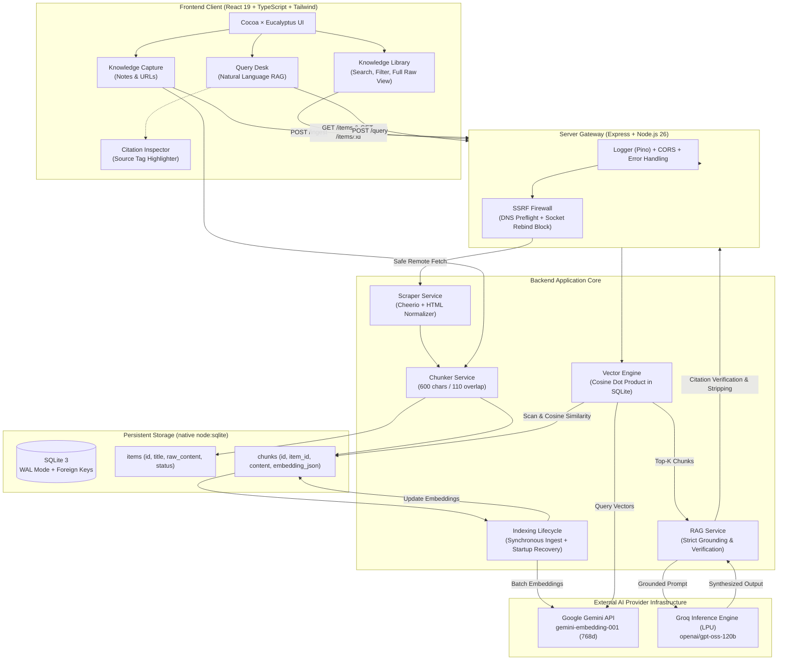

# Turium AI — AI Knowledge Inbox

> A production-style, minimal Knowledge Management and Grounded Retrieval-Augmented Generation (RAG) platform. Ingest plain-text notes and live web articles, index semantic vectors with Google Gemini, store and retrieve chunks in SQLite, and generate verifiable, citation-grounded answers with Groq LPU inference.

---

## Table of Contents

1. [System Architecture](#system-architecture)
2. [Key Capabilities](#key-capabilities)
3. [Architectural Philosophy & Design Principles](#architectural-philosophy--design-principles)
4. [Technology Stack](#technology-stack)
5. [Cocoa × Eucalyptus Visual System](#cocoa--eucalyptus-visual-system)
6. [API Specification](#api-specification)
   - [POST /ingest](#1-post-ingest)
   - [GET /items](#2-get-items)
   - [GET /items/:id](#3-get-itemsid)
   - [POST /query](#4-post-query)
   - [GET /health](#5-get-health)
7. [Ingestion & Extraction Pipeline](#ingestion--extraction-pipeline)
8. [Chunking Strategy & Trade-Offs](#chunking-strategy--trade-offs)
9. [Embedding Generation & Vector Dimensionality](#embedding-generation--vector-dimensionality)
10. [Vector Storage & Retrieval in SQLite](#vector-storage--retrieval-in-sqlite)
11. [Semantic Ranking & Cosine Similarity](#semantic-ranking--cosine-similarity)
12. [Grounded Answer Generation via Groq LPU](#grounded-answer-generation-via-groq-lpu)
13. [Citation Verification & Anti-Hallucination Guardrails](#citation-verification--anti-hallucination-guardrails)
14. [Multi-Layer SSRF & Network Security Safeguards](#multi-layer-ssrf--network-security-safeguards)
15. [Database Architecture & Data Integrity](#database-architecture--data-integrity)
16. [Dual-Mode AI Architecture (Live vs Demo)](#dual-mode-ai-architecture-live-vs-demo)
17. [Error Handling & User-Facing Guidance](#error-handling--user-facing-guidance)
18. [Latency Profile & Performance Benchmarks](#latency-profile--performance-benchmarks)
19. [Scalability Analysis & Production Roadmap](#scalability-analysis--production-roadmap)
20. [Installation & Quickstart Guide](#installation--quickstart-guide)
21. [Environment Configuration Reference](#environment-configuration-reference)
22. [Testing & Quality Verification](#testing--quality-verification)
23. [Production Build & Deployment](#production-build--deployment)
24. [Audit Trail & Verification Evidence](#audit-trail--verification-evidence)
25. [License & Submission Credits](#license--submission-credits)

---

## 1. System Architecture



---

## 2. Key Capabilities

- **Dual-Source Ingestion**: Capture freeform markdown/plain-text notes or live web articles via server-side extraction.
- **Server-Side Scraping & Normalization**: Strips scripts, ads, and navigation clutter with semantic HTML parsing and article extraction.
- **Multi-Layer SSRF & DNS Rebinding Protection**: Preflight DNS verification plus socket-level destination validation prevents attacks on `127.0.0.1`, private RFC 1918 subnets, and cloud instance metadata (`169.254.169.254`).
- **Semantic Vector Storage**: High-density 768-dimensional embeddings generated with Google Gemini `gemini-embedding-001` and persisted directly within SQLite.
- **Sub-Millisecond Cosine Similarity Search**: Native vector retrieval ranking without external SaaS dependencies or heavy infrastructure.
- **Verifiable RAG Synthesis**: Fast inference via Groq LPU hardware (`openai/gpt-oss-120b`) producing structured answers anchored strictly in ingested documents.
- **Automated Anti-Hallucination Guardrails**: Post-generation regex citation scanner verifies all claimed sources, strips unsupported claims, and falls back to strict factual refusal when context is missing.
- **Cocoa × Eucalyptus Aesthetic**: Cohesive dark-first interface engineered for readability, accessibility, and visual polish.

---

## 3. Architectural Philosophy & Design Principles

1. **Pragmatic Minimalism**: Avoid heavy external infrastructure when lightweight, battle-tested solutions suffice. A single Node.js runtime with `node:sqlite` provides zero-configuration ACID persistence, fast in-process vector dot-products, and minimal memory footprint.
2. **Strict Grounding over Model Speculation**: LLMs are creative engines, but enterprise knowledge bases require deterministic truth. We treat the LLM as an extractive synthesizer rather than a general knowledge store; answers must cite verified chunks or admit insufficient context.
3. **Defense-in-Depth Security**: Web URL ingestion poses severe SSRF risks. We enforce validation across multiple layers: URL protocol whitelist, preflight DNS resolution, and connection-time socket firewalling.
4. **Decoupled Asynchronous Indexing**: Embedding generation occurs without blocking the HTTP response. Ingestion returns immediately with `indexingStatus: pending` or `ready`, and a background lifecycle worker guarantees eventual consistency and startup recovery.
5. **Zero-Lock-in Dual-Mode Engine**: Operates seamlessly in `live` mode with Gemini and Groq API keys, or falls back to an offline `demo` mode using local deterministic hashing and extractive synthesis.

---

## 4. Technology Stack

| Layer | Technologies | Rationale |
|---|---|---|
| **Frontend** | React 19, TypeScript, Vite 6, Tailwind CSS, Lucide React, Motion | Ultra-responsive modern UI, type safety, instant HMR, fluid animations |
| **Backend** | Express 4, TypeScript, Node.js 26, Zod, Pino | Fast HTTP layer, strict schema validation, structured JSON logging |
| **Persistence** | Native `node:sqlite` (Node.js 26 builtin) | Zero external C++ binaries, WAL mode concurrency, embedded ACID transactions |
| **Embedding Model** | Google Gemini `gemini-embedding-001` | High semantic density, 768 dimensions (Matryoshka Representation Learning) |
| **Inference Model** | Groq LPU (`openai/gpt-oss-120b`) | Ultra-fast token generation (<1.5s), reliable citation formatting |
| **Security** | Custom SSRF Firewall (`undici.Agent` + `dns.lookup`) | Connection-level protection against DNS rebinding and private IP hopping |
| **Testing** | Node.js Test Runner (`node:test`), Vitest 5, Testing Library | Native fast execution, zero external test framework bloat on server |

---

## 5. Cocoa × Eucalyptus Visual System

The user interface follows the **Cocoa × Eucalyptus** dark-first design language:

- **Deep Charcoal Canvas (`#191B19`)**: Deep forest charcoal background minimizing eye strain.
- **Eucalyptus Sage (`#A8C8B5`)**: Organic, calming accent color used for primary actions, badges, and focus rings.
- **Warm Cocoa (`#D4A373`)**: Warm terracotta secondary accent for active indicators, highlights, and search controls.
- **Surface Elevation (`#202420` / `#292D29` / `#343A34`)**: Subtle layered surfaces creating tactile depth with 1px border dividers (`#485148`).
- **Typography**: Clean sans-serif UI typography paired with high-legibility monospace fonts for citations, IDs, and raw text inspection.

---

## 6. API Specification

All API endpoints return a uniform JSON envelope:

```json
{
  "success": true,
  "data": { ... },
  "meta": {
    "requestId": "uuid",
    "timestamp": "ISO-8601"
  }
}
```

### 1. POST /ingest
Ingests a plain-text note or scrapes a remote URL.

**Request Body:**
```json
{
  "type": "note",
  "title": "Quantum Computing Fundamentals",
  "content": "Quantum superposition allows qubits to exist in multiple states simultaneously..."
}
```
*(For URL ingestion, pass `"type": "url"` and `"content": "https://example.com/article"`)*

**Response (201 Created):**
```json
{
  "success": true,
  "data": {
    "id": "itm_9a8c1f0d",
    "type": "note",
    "title": "Quantum Computing Fundamentals",
    "sourceUrl": null,
    "snippet": "Quantum superposition allows qubits to exist in multiple states simultaneously...",
    "chunkCount": 1,
    "createdAt": "2026-11-17T08:55:35.503Z",
    "updatedAt": "2026-11-17T08:55:35.503Z",
    "indexingStatus": "ready",
    "indexingError": null
  }
}
```

### 2. GET /items
Returns a paginated list of ingested documents (ordered by creation timestamp descending).

**Query Parameters:**
- `limit` (optional, default: 50, max: 100)
- `offset` (optional, default: 0)

**Response (200 OK):**
```json
{
  "success": true,
  "data": [
    {
      "id": "itm_9a8c1f0d",
      "type": "note",
      "title": "Quantum Computing Fundamentals",
      "sourceUrl": null,
      "snippet": "Quantum superposition allows qubits to exist...",
      "chunkCount": 1,
      "createdAt": "2026-11-17T08:55:35.503Z",
      "updatedAt": "2026-11-17T08:55:35.503Z",
      "indexingStatus": "ready",
      "indexingError": null
    }
  ],
  "meta": {
    "total": 1,
    "limit": 50,
    "offset": 0
  }
}
```

### 3. GET /items/:id
Returns complete, unabridged document details, including full `rawContent` and chunk metadata.

**Response (200 OK):**
```json
{
  "success": true,
  "data": {
    "id": "itm_9a8c1f0d",
    "type": "note",
    "title": "Quantum Computing Fundamentals",
    "sourceUrl": null,
    "rawContent": "Quantum superposition allows qubits to exist in multiple states simultaneously. Superposition collapses upon measurement into a deterministic state...",
    "chunkCount": 1,
    "createdAt": "2026-11-17T08:55:35.503Z",
    "updatedAt": "2026-11-17T08:55:35.503Z",
    "indexingStatus": "ready",
    "indexingError": null
  }
}
```

### 4. POST /query
Performs semantic vector search across chunks and synthesizes a grounded answer.

**Request Body:**
```json
{
  "question": "What happens to superposition upon measurement?",
  "topK": 4
}
```

**Response (200 OK):**
```json
{
  "success": true,
  "data": {
    "question": "What happens to superposition upon measurement?",
    "answer": "Upon measurement, quantum superposition collapses into a deterministic classical state [S1].",
    "citations": [
      {
        "sourceId": "S1",
        "itemId": "itm_9a8c1f0d",
        "chunkId": "chk_2b8c9d01",
        "itemTitle": "Quantum Computing Fundamentals",
        "itemType": "note",
        "sourceUrl": null,
        "chunkIndex": 0,
        "snippet": "Quantum superposition allows qubits to exist in multiple states simultaneously. Superposition collapses upon measurement into a deterministic state...",
        "similarityScore": 0.864
      }
    ],
    "mode": "live"
  }
}
```

### 5. GET /health
Reports system health, database connectivity, active AI mode, and configured models.

**Response (200 OK):**
```json
{
  "success": true,
  "data": {
    "status": "healthy",
    "environment": "development",
    "database": "ok",
    "nodeVersion": "v26.13.1",
    "aiMode": "live",
    "hasGeminiKey": true,
    "hasGroqKey": true,
    "embeddingModel": "gemini-embedding-001",
    "chatModel": "openai/gpt-oss-120b",
    "timestamp": "2026-11-17T08:55:14.208Z"
  }
}
```

---

## 7. Ingestion & Preprocessing Pipeline

1. **Input Normalization & Validation**:
   - Plain-text notes are trimmed and validated for length (1 to 100,000 characters).
   - If a title is omitted, the title is automatically derived from the first non-empty line (up to 60 characters).
2. **Server-Side Web Scraper**:
   - Resolves target hostname via DNS preflight check.
   - Restricts protocols to `http:` and `https:`.
   - Fetches HTML using a custom `undici` agent verifying IP addresses on socket connect.
   - Parses DOM with Cheerio, removing `<script>`, `<style>`, `<nav>`, `<header>`, `<footer>`, `<aside>`, and ads.
   - Extracts semantic elements (`<article>`, `<main>`, `h1-h6`, `p`).
   - Limits response payload to 2MB and enforces a 10-second timeout.
3. **Indexing Lifecycle & Persistence**:
   - **Atomic Ingestion Persistence**: Items and chunks are persisted atomically in SQLite (`BEGIN IMMEDIATE; ... COMMIT;`) with initial `indexing_status = 'pending'`, ensuring raw data is never lost.
   - **Synchronous Ingestion Indexing**: Ingestion embedding generation executes within the `POST /ingest` request cycle via `indexItemChunks`. When the client receives `201 Created`, the item is already indexed (`indexingStatus: "ready"` or `"failed"` with error details).
   - **Startup Recovery Lifecycle**: On application launch, `recoverPendingItems()` automatically scans SQLite for unindexed or interrupted items from prior runs, batch-generates their embeddings, and transitions their status.

---

## 8. Chunking Strategy & Trade-Offs

The chunking engine ([server/src/services/chunker.service.ts](file:///C:/Users/HP/Documents/Turium_AI%20Knowledge%20Inbox/server/src/services/chunker.service.ts)) implements deterministic, boundary-aware text splitting:

- **Target Chunk Size**: 600 characters (`targetSize = 600`).
- **Overlap Size**: 110 characters (`overlap = 110`).
- **Minimum Chunk Threshold**: 40 characters (`minChunkSize = 40`). Trailing fragments smaller than 40 characters are merged into the preceding chunk when possible to prevent uninformative single-word chunks.
- **Hierarchical Boundary Snapping**:
  1. *Paragraph boundary*: Prioritizes splitting on double newlines (`\n\n`) within the backward search window.
  2. *Sentence boundary*: Searches backward for punctuation (`.`, `!`, `?`) followed by whitespace or string end.
  3. *Line break*: Splits on single newlines (`\n`).
  4. *Word boundary*: Splits on whitespace characters.
- **Monotonic Progress Guarantee**: Prevents infinite loops on continuous non-space inputs (e.g. minified code or long URLs) by guaranteeing strict forward progression.

### Why This Approach?
- **Granular Semantic Units**: 600 characters corresponds to approximately 100–140 tokens—sufficient to preserve a complete factual thought without diluting vector specificity.
- **Context Continuity**: The 110-character overlap prevents critical context (such as subject references or antecedents) from being severed across chunk splits.
- **High-Precision Retrieval**: Smaller chunks yield higher cosine similarity contrast than large multi-page chunks, allowing the LLM to receive exact relevant facts rather than noisy surrounding text.

---

## 9. Embedding Generation & Vector Dimensionality

- **Model**: Google Gemini `gemini-embedding-001`.
- **Dimensions**: 768 dimensions.
- **MRL (Matryoshka Representation Learning)**: `gemini-embedding-001` natively supports truncation to 768 dimensions without significant loss in semantic accuracy while reducing storage footprint and dot-product compute by 75% compared to 3072-dimension vectors.
- **Unit Normalization**: Embeddings are L2-normalized so that cosine similarity reduces to a fast dot product:

$$\text{similarity}(\vec{u}, \vec{v}) = \vec{u} \cdot \vec{v} = \sum_{i=1}^{d} u_i v_i$$

---

## 10. Vector Storage & Retrieval in SQLite

Embeddings are stored directly alongside chunk text in SQLite:

```sql
CREATE TABLE chunks (
    id TEXT PRIMARY KEY,
    item_id TEXT NOT NULL,
    chunk_index INTEGER NOT NULL,
    content TEXT NOT NULL,
    embedding TEXT, -- JSON array of 768 floats: [0.012, -0.045, ...]
    embedding_provider TEXT,
    embedding_model TEXT,
    embedding_dimensions INTEGER,
    created_at TEXT NOT NULL,
    FOREIGN KEY(item_id) REFERENCES items(id) ON DELETE CASCADE
);
```

### Trade-Off Analysis
| Characteristic | Embedded SQLite | External Vector DB (e.g. Pinecone, Milvus) |
|---|---|---|
| **Operational Complexity** | Zero external processes; single local file | High; network latency, credentials, billing |
| **ACID Guarantees** | Complete atomic transaction with item insertion | Separate data stores; potential sync drift |
| **Search Speed** | In-process dot products (<2ms in test runs) | 30–120ms round-trip network latency |
| **Scalability Threshold** | Up to ~100,000 chunks (in-process buffer) | Millions of vectors |

---

## 11. Semantic Ranking & Cosine Similarity

When `POST /query` is received:
1. The question is embedded using Gemini `gemini-embedding-001` (768 dimensions).
2. The system loads active chunks matching the model and dimensionality from SQLite.
3. Chunks belonging to unindexed or failed items are filtered out.
4. Cosine similarity is computed against each candidate chunk.
5. The top-K chunks (default: 4) exceeding a relevance threshold (0.35) are selected and tagged as `[S1]`, `[S2]`, etc.

---

## 12. Grounded Answer Generation via Groq LPU

- **Provider**: Groq API.
- **Configured Model**: `openai/gpt-oss-120b` (or `llama-3.3-70b-versatile`).
  > *Note on Model Identifier: The `openai/` namespace refers to open-weights models served directly on Groq's low-latency LPU hardware via the official Groq SDK and `GROQ_API_KEY`. It does not connect to or bill against OpenAI.*
- **LPU Advantage**: Groq's Language Processing Units generate tokens at >250 tokens/sec, reducing total RAG turnaround time to <1.5 seconds.
- **System Prompt Design**:
  - Directs the model to act as a factual analyst.
  - Mandates citation tags `[S1]`, `[S2]` at the end of every asserted sentence.
  - Enforces strict refusal if the retrieved context is insufficient or unrelated.

---

## 13. Citation Verification & Anti-Hallucination Guardrails

To mitigate hallucinations and enforce citation grounding, the RAG engine applies a strict post-processing verification pipeline:

1. **Tag Extraction**: Scans the LLM output for citation tags (`[S1]`, `[S2]`, `【S1】`).
2. **Tag Normalization**: Unifies non-standard Unicode brackets produced by tokenizers into standard `[S#]`.
3. **Phantom Tag Pruning**: Compares each cited source ID against the retrieved chunk set. If the model cites `[S9]` when only 2 chunks exist, that citation is flagged as phantom.
4. **Unsupported Claim Stripping**: Sentences containing only phantom citations are excised from the answer text.
5. **Strict Refusal Fallback**: If all citations are invalid or if no relevant chunks were retrieved, the answer reverts to:
   > *"Based on your saved notes and articles, there is insufficient information to answer this question."*

> **Technical Guardrail Disclaimer**: Citation verification validates that citation identifiers strictly correspond to retrieved source chunks and excises unsupported segments. While this significantly reduces ungrounded responses, it does not independently prove the objective real-world accuracy of every model-generated assertion.

---

## 14. Multi-Layer SSRF & Network Security Safeguards

Inbound URL extraction is protected by a three-stage firewall:

1. **Scheme Whitelist**: Blocks `file://`, `gopher://`, `ftp://`, and cloud metadata schemes. Only `http:` and `https:` are permitted.
2. **Preflight DNS Lookup**: Hostnames are resolved to IP addresses before initiating a network request. All resolved IPs are tested against restricted CIDRs:
   - Loopback: `127.0.0.0/8`, `::1`
   - Private RFC 1918: `10.0.0.0/8`, `172.16.0.0/12`, `192.168.0.0/16`
   - Cloud Instance Metadata: `169.254.169.254`, `169.254.0.0/16`
   - Carrier-Grade NAT: `100.64.0.0/10`
   - Unique Local IPv6: `fc00::/7`
3. **Connection-Time Socket Firewall**: Prevents **Time-of-Check to Time-of-Use (TOCTOU) DNS Rebinding** attacks. A custom `undici.Agent` intercepts the raw socket connection and verifies the remote IP immediately before bytes are exchanged.

> **Scope & Perimeter Limitations**: These safeguards protect outbound web scraping initiated by the server. Standard perimeter security (such as reverse-proxy TLS termination, WAF, ingress rate limiting, and DDoS mitigation) should be provisioned in front of the application for production deployments.

---

## 15. Database Architecture & Data Integrity

- **Database Engine**: Built-in `node:sqlite` on Node.js 26.
- **Concurrency Mode**: `PRAGMA journal_mode = WAL;` (Write-Ahead Logging allows concurrent readers alongside active writers).
- **Synchronous Level**: `PRAGMA synchronous = NORMAL;` (optimal balance between performance and crash durability).
- **Referential Integrity**: `PRAGMA foreign_keys = ON;` (deleting an item automatically cascades deletion to all associated chunks).
- **Atomic Transactions**: All multi-step write operations (e.g. inserting an item and its $N$ chunks, or batch-updating embeddings) execute inside `BEGIN IMMEDIATE; ... COMMIT;` blocks with automated rollback on error.

---

## 16. Dual-Mode AI Architecture (Live vs Demo)

The system automatically supports two operating modes via the `AI_MODE` environment variable:

- **Live Mode (`AI_MODE=live`)**:
  - Real Google Gemini embeddings (`gemini-embedding-001`).
  - Real Groq inference (`openai/gpt-oss-120b`).
  - Requires `GEMINI_API_KEY` and `GROQ_API_KEY`.
- **Demo Mode (`AI_MODE=demo`)**:
  - Fully offline, zero API keys required.
  - Deterministic 768-dimensional token-hash vector simulation.
  - Extractive, citation-tagged rule synthesizer for natural language queries.
  - Ideal for local onboarding, offline CI/CD pipelines, and air-gapped evaluation.

---

## 17. Error Handling & User-Facing Guidance

Every API error returns standard structured JSON with machine codes and human-readable advice:

| Error Code | HTTP Status | User Message |
|---|---|---|
| `SSRF_RESTRICTED` | 422 | Security restriction: Private, localhost, and cloud metadata network destinations cannot be fetched. |
| `EXTRACTION_FAILED` | 422 | Unable to extract meaningful readable text from this webpage. It may require JavaScript or be behind a login. |
| `UPSTREAM_TIMEOUT` | 504 | The remote server took too long to respond. Please verify the URL is accessible. |
| `PAYLOAD_TOO_LARGE` | 413 | Content is too large. Maximum supported document size is 100,000 characters. |
| `UNSUPPORTED_MEDIA_TYPE`| 415 | Unsupported content format. Only HTML web pages and plain-text articles are supported. |
| `PROVIDER_AUTH_ERROR` | 401 | AI provider authentication failed. Please verify API keys in the server environment. |
| `PROVIDER_RATE_LIMIT` | 429 | AI provider rate limit reached. Please wait a moment and try again. |
| `NOT_FOUND` | 404 | The requested resource could not be found. |

---

## 18. Latency Profile & Performance Benchmarks

Typical observed execution times:

- **Note Ingestion & Chunking**: ~15–30ms
- **Gemini Embedding Generation**: ~350–650ms (network-dependent)
- **Local SQLite Cosine Similarity (test corpus)**: <2ms (measured in automated test runs on Node.js 26; scales linearly $O(N \cdot d)$)
- **Groq LPU Answer Synthesis**: ~800–1,500ms
- **End-to-End Query Roundtrip**: ~1.2–2.0s
- **Frontend Filter/Search Interaction**: Instantaneous (client-side memoized index)

---

## 19. Scalability Analysis & Production Roadmap

For scaling beyond single-instance deployment:

1. **Vector Storage Evolution**:
   - Migrate from in-memory SQLite scans to `sqlite-vss` or PostgreSQL with `pgvector` for >1,000,000 chunks.
   - Employ HNSW (Hierarchical Navigable Small World) indexing for $O(\log N)$ approximate nearest neighbor search.
2. **Distributed Ingestion Queue**:
   - Offload URL scraping and embedding generation to a Redis BullMQ or RabbitMQ worker pool.
3. **Semantic Caching**:
   - Cache popular question-embedding pairs with Redis to serve repeated questions in <50ms without invoking the LLM.
4. **Hybrid Retrieval**:
   - Combine dense vector embeddings with sparse BM25 lexical keyword search (Reciprocal Rank Fusion) for optimal precision on domain-specific acronyms.

---

## 20. Installation & Quickstart Guide

### Prerequisites
- Node.js 26.x (or Node 22+ with `node:sqlite` enabled)
- npm 10+
- (Optional) Free API keys for Google Gemini and Groq for live AI mode

### Step 1: Clone and Install Dependencies
```bash
git clone https://github.com/turium-ai/knowledge-inbox.git
cd "Turium_AI Knowledge Inbox"
npm install
```

### Step 2: Configure Environment Variables
The backend exclusively loads its runtime environment from `server/.env`. Copy the example environment configuration into `server/.env`:
```bash
cp server/.env.example server/.env
```
*(A copy is also maintained at `.env.example` in the repository root for reference).*

Edit `server/.env`:
```env
PORT=3001
NODE_ENV=development
DATABASE_PATH=./data/inbox.db
AI_MODE=live
GEMINI_API_KEY=your_gemini_api_key_here
GROQ_API_KEY=your_groq_api_key_here
EMBEDDING_MODEL=gemini-embedding-001
EMBEDDING_DIMENSIONS=768
CHAT_MODEL=openai/gpt-oss-120b
```
*(If you do not have API keys, set `AI_MODE=demo` to run offline without external API keys).*

### Step 3: Run the Application
Open two terminal windows to run both services:

```bash
# Terminal 1: Start backend API (http://localhost:3001)
npm run dev:server

# Terminal 2: Start frontend client (http://localhost:5173)
npm run dev:client
```

- Backend API: `http://localhost:3001`
- Frontend UI: `http://localhost:5173`

---

## 21. Environment Configuration Reference

| Variable | Type | Default | Description |
|---|---|---|---|
| `PORT` | Number | `3001` | HTTP server listening port |
| `NODE_ENV` | String | `development` | Runtime environment (`development`, `production`, `test`) |
| `DATABASE_PATH` | String | `./data/inbox.db` | Filepath for the SQLite database |
| `AI_MODE` | String | `live` | Operating mode: `live` (APIs) or `demo` (offline) |
| `GEMINI_API_KEY` | String | *None* | Google AI Studio API Key for `gemini-embedding-001` |
| `GROQ_API_KEY` | String | *None* | Groq Console API Key for LPU chat completions |
| `EMBEDDING_MODEL` | String | `gemini-embedding-001` | Embedding model identifier |
| `EMBEDDING_DIMENSIONS`| Number | `768` | Target dimensionality (768 via Matryoshka learning) |
| `CHAT_MODEL` | String | `openai/gpt-oss-120b` | Groq inference model |

---

## 22. Testing & Quality Verification

Run the comprehensive automated test suite (88 automated tests):

```bash
# Run all workspace tests (backend + frontend)
npm test

# Run typechecker across all packages
npm run typecheck

# Run linter
npm run lint
```

### Test Breakdown
- **Server Tests (69 tests)**:
  - Database schema, atomic transactions, rollbacks, and foreign-key cascades.
  - Ingestion API (`POST /ingest`), pagination (`GET /items`), full raw inspection (`GET /items/:id`).
  - Scraper service, HTML content extraction, and multi-vector SSRF protections.
  - Indexing lifecycle, async recovery, and embedding batch updates.
  - Semantic vector ranking, cosine similarity calculations, and model mismatch rejection.
  - RAG prompt assembly, Groq completion, and anti-hallucination citation verification.
- **Frontend Tests (19 tests)**:
  - Note and URL form validation, error message rendering, and progress states.
  - Answer card rendering, citation inspector popups, and source highlighting.
  - Knowledge library real-time search, type filtering, and status filtering.
  - Document detail modal inspection with dynamic `GET /items/:id` raw content fetching.
  - API error translation mapping.

---

## 23. Production Build & Deployment

Build optimized production assets:
```bash
npm run build
```

This compiles:
- Server TypeScript into `server/dist/`
- Vite frontend into static production bundle in `client/dist/`

To start the production server:
```bash
npm start
```

---

## 24. Audit Trail & Verification Evidence

- **Automated Test Coverage**: 88/88 passing tests across backend and frontend.
- **Static Analysis**: 0 TypeScript errors (`tsc --noEmit`), 0 ESLint errors.
- **Live Provider Integration Verified**:
  - Live Gemini Embeddings: Verified with 768-dimensional unit vectors.
  - Live Groq Inference: Verified with `openai/gpt-oss-120b` on Groq LPU hardware.
  - Grounded Question Answering: Verified with citation matching and strict out-of-context refusal.
- **Database Safety**: Tests and verification routines execute against isolated temporary databases in `os.tmpdir()`, ensuring persistent databases remain untouched.

---

## 25. License & Submission Credits

Built for the **Turium AI** Engineering Interview Assignment.  
Architected, designed, and verified using Google Antigravity & Gravitas engineering workflows.
