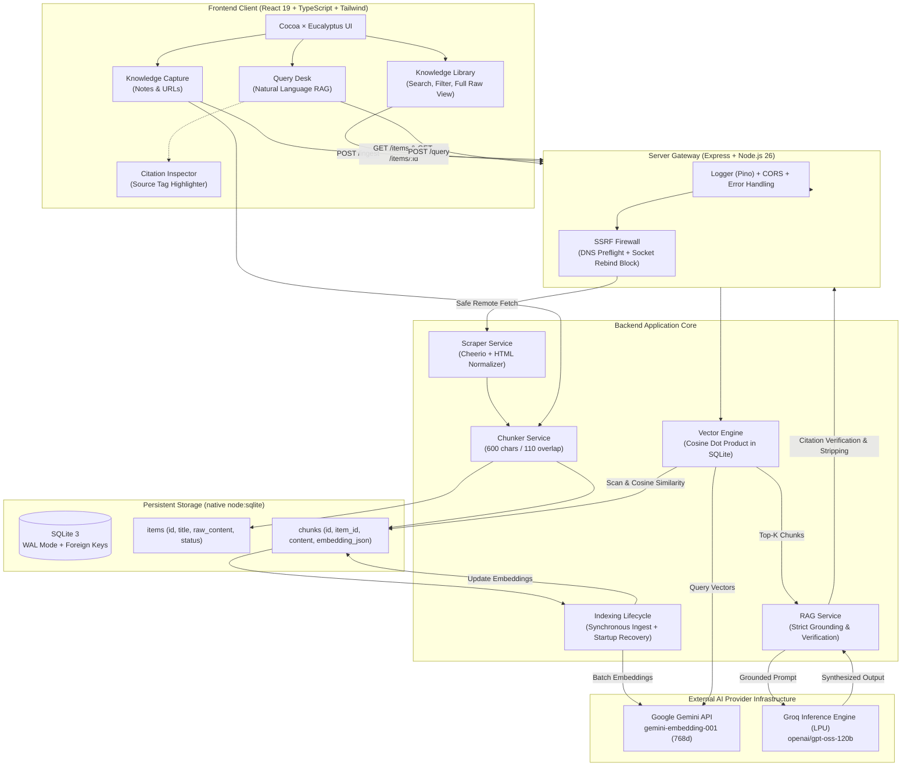

# Turium AI — AI Knowledge Inbox

A full-stack knowledge management and grounded Retrieval-Augmented Generation (RAG) application. Users ingest plain-text notes or live web articles, index text chunks in SQLite, and ask questions to receive answers anchored in retrieved sources with verifiable citation tags.

---

## 1. Project Overview

Turium AI Knowledge Inbox is a personal research repository paired with a question-answering assistant. When you add a note or web URL, the application extracts the text, splits it into deterministic overlapping chunks, generates 768-dimensional embeddings, and persists everything in a local SQLite database.

When querying the knowledge base, the backend embeds the question, runs an in-memory cosine similarity scan over stored chunk vectors, and supplies the top-ranked context to an LLM. The model synthesizes an answer constrained to that context, referencing sources with bracketed tags like `[S1]` and `[S2]`. A server-side verification filter checks these tags against retrieved chunks before the answer reaches the user.

The project is structured as an npm workspace containing an Express TypeScript backend and a React 19 TypeScript frontend styled with Tailwind CSS using a Cocoa × Eucalyptus dark-first palette.

---

## 2. Features

- **Note & URL Ingestion**: Ingest markdown or plain-text notes, or scrape web articles. Scraped HTML is cleaned with Cheerio to remove scripts, styles, and navigation chrome.
- **SSRF Safeguards**: URL fetching validates protocols, resolves DNS preflight, and blocks loopback (`127.0.0.1`), private RFC 1918 subnets, and cloud metadata endpoints (`169.254.169.254`).
- **Deterministic Chunking**: Splits text into 600-character windows with 110-character overlap, prioritizing paragraph, sentence, and word boundaries.
- **Embedded SQLite Storage**: Powered by Node.js 26 native `node:sqlite` in WAL mode for ACID persistence without external database dependencies.
- **Grounded Answer Generation**: Uses Groq (`openai/gpt-oss-120b`) with a system prompt requiring claims to cite specific retrieved chunks. Returns a strict refusal when context is insufficient.
- **Citation Verification Guardrail**: Post-generation regex scanner validates that every cited tag maps to a retrieved chunk, strips unsupported statements, and links sources to chunk snippets.
- **Dual AI Modes**: Operates in `live` mode with Google Gemini and Groq APIs, or in `demo` mode completely offline without credentials using deterministic hashing and extractive matching.
- **Cocoa × Eucalyptus UI**: Responsive interface with real-time system diagnostics, searchable library, raw content viewer modal, and an interactive citation inspector drawer.

---

## 3. Tech Stack

| Layer | Technology | Purpose |
|---|---|---|
| **Frontend** | React 19, TypeScript, Vite 6, Tailwind CSS v4, Motion | Client UI, capture forms, library filtering, citation drawer |
| **Backend** | Node.js 26, Express 4, TypeScript, Zod, Pino | REST API, request schema validation, structured JSON logging |
| **Persistence** | Native `node:sqlite` (Node.js 26 builtin) | Embedded storage, WAL mode concurrency, relational foreign keys |
| **Embedding Model** | Google Gemini `gemini-embedding-001` (768d) | Document and query vector generation in live mode |
| **Inference Model** | Groq API (`openai/gpt-oss-120b`) | Grounded answer synthesis with source citation formatting |
| **HTML Extraction** | Cheerio, Undici custom Agent | Article text extraction and SSRF-safe HTTP fetching |
| **Testing** | Node.js Test Runner (`node:test`), Vitest 5 | 88 automated unit, component, and integration tests |

---

## 4. Quick Start

### Prerequisites
- Node.js 26+ (recommended for native `node:sqlite`)
- npm 10+

### Installation

```bash
git clone https://github.com/ramcharan0308/turium-ai-knowledge-inbox.git
cd turium-ai-knowledge-inbox
npm ci
```

### Configure Environment

Copy the example environment file:

**Bash:**
```bash
cp server/.env.example server/.env
```

**PowerShell:**
```powershell
Copy-Item server/.env.example server/.env
```

### Option A: Demo Mode (No API keys required — Recommended for quick evaluation)

Ensure `server/.env` contains:

```env
AI_MODE=demo
```

In demo mode, embeddings are computed locally using deterministic hashing and queries return matching extracted passages offline. No external API credentials are required.

### Option B: Live AI Mode (Gemini + Groq)

To enable live AI models, set your keys in `server/.env`:

```env
AI_MODE=live
GEMINI_API_KEY=your_gemini_api_key_here
GROQ_API_KEY=your_groq_api_key_here
EMBEDDING_MODEL=gemini-embedding-001
EMBEDDING_DIMENSIONS=768
CHAT_MODEL=openai/gpt-oss-120b
```

- **Gemini API Key**: Available from [Google AI Studio](https://aistudio.google.com/).
- **Groq API Key**: Available from [Groq Console](https://console.groq.com/).

### Running the Application

Start backend and frontend services:

```bash
# Terminal 1: Backend API (runs on http://localhost:3001)
npm run dev:server

# Terminal 2: Frontend Client (runs on http://localhost:5173)
npm run dev:client
```

Open **http://localhost:5173** in your browser. Backend health can be checked at **http://localhost:3001/health**.

---

## 5. System Architecture



---

## 6. How It Works

The system processes data across six sequential stages:

1. **Ingestion & Validation**: Requests to `POST /ingest` are validated with Zod. For URLs, the scraper resolves DNS to confirm the host is not an internal or loopback IP, fetches the HTML via Undici, and extracts article text using Cheerio.
2. **Text Chunking**: `ChunkerService` segments the raw text into ~600-character windows with a 110-character overlap. The splitter searches backward from the target boundary for natural break points (paragraphs, sentence endings, newlines, or spaces).
3. **Storage & Ingestion Indexing**: Items and chunks are saved to SQLite in an ACID transaction. Ingestion generates embeddings synchronously within the HTTP request using Gemini `gemini-embedding-001` (or local hashing in demo mode), updating status from `pending` to `ready`. A startup recovery routine handles any pending items if an earlier process was interrupted.
4. **Vector Retrieval**: Upon receiving a query at `POST /query`, the server computes the query embedding and performs an in-memory cosine similarity scan against stored chunk vectors. The top candidates (default: top 5, similarity > 0.35) are retrieved.
5. **Grounded Answer Synthesis**: Retrieved chunks are injected into a structured system prompt as numbered sources (`[S1]`, `[S2]`) and sent to Groq (`openai/gpt-oss-120b`). The model is instructed to answer using only the provided facts, cite source tags immediately following claims, or state that context is insufficient.
6. **Citation Verification**: The server extracts all `[S#]` tags from the response and verifies that each maps to a valid retrieved chunk. Any sentence citing nonexistent or ungrounded sources is stripped. If all citations fail or the answer is ungrounded, the system returns a standard refusal.

---

## 7. API Endpoints

All responses use a standard envelope: `{ "success": boolean, "data": ..., "meta": { "requestId": string, "timestamp": string } }`.

| Endpoint | Method | Description | Request / Response Summary |
|---|---|---|---|
| `/ingest` | `POST` | Ingest a plain text note or scrape a web URL | `{ type: "note" \| "url", title?: string, content: string }` &rarr; `201 Created` |
| `/items` | `GET` | List ingested items with pagination | Query: `limit` (default 50), `offset` (default 0) &rarr; `200 OK` |
| `/items/:id` | `GET` | Retrieve single item with complete `rawContent` | Path param: `:id` &rarr; `200 OK` |
| `/query` | `POST` | Query the knowledge base with grounded RAG | `{ query: string }` &rarr; `200 OK` with answer and citations |
| `/health` | `GET` | System diagnostics, AI mode, and counts | None &rarr; `200 OK` |

### Ingestion Example

**Request:**
```http
POST /ingest HTTP/1.1
Content-Type: application/json

{
  "type": "note",
  "title": "Quantum Computing",
  "content": "Superposition allows qubits to exist in multiple states simultaneously until measurement collapses them."
}
```

**Response (201 Created):**
```json
{
  "success": true,
  "data": {
    "id": "itm_9a8c1f0d",
    "type": "note",
    "title": "Quantum Computing",
    "sourceUrl": null,
    "snippet": "Superposition allows qubits to exist in multiple states...",
    "chunkCount": 1,
    "createdAt": "2026-11-17T08:55:35.503Z",
    "indexingStatus": "ready"
  }
}
```

### Query Example

**Request:**
```http
POST /query HTTP/1.1
Content-Type: application/json

{
  "query": "What is superposition?"
}
```

**Response (200 OK):**
```json
{
  "success": true,
  "data": {
    "answer": "Superposition allows qubits to exist in multiple states simultaneously until measurement collapses them [S1].",
    "citations": [
      {
        "sourceId": "S1",
        "itemId": "itm_9a8c1f0d",
        "itemTitle": "Quantum Computing",
        "chunkId": "chk_4b2e8a1c",
        "snippet": "Superposition allows qubits to exist in multiple states simultaneously until measurement collapses them.",
        "score": 0.884
      }
    ],
    "model": "openai/gpt-oss-120b",
    "mode": "live"
  }
}
```

---

## 8. Design Decisions & Trade-offs

- **Why SQLite (`node:sqlite`)?**
  - *Decision*: Native `node:sqlite` in WAL mode provides embedded ACID persistence without managing an external database container.
  - *Trade-off*: Vector retrieval uses an in-memory scan over chunk embeddings stored as JSON strings. For personal research libraries (thousands of chunks), this is fast and simple. For datasets with hundreds of thousands of chunks, an indexed vector extension like `sqlite-vec` or an external vector engine would be preferred.
- **Why 600-Character Chunks with 110-Character Overlap?**
  - *Decision*: 600-character windows (~90–120 words) with a 110-character overlap.
  - *Trade-off*: Compact chunks provide focused semantic embeddings that retrieve specific facts without crowding the LLM prompt. The overlap prevents key sentences from being split in half across boundaries. The trade-off is an increased number of chunk rows and embedding requests compared to larger chunk sizes.
- **Why Gemini for Embeddings and Groq for Chat?**
  - *Decision*: Gemini `gemini-embedding-001` generates 768-dimensional vectors with task-specific embedding types (`RETRIEVAL_DOCUMENT` and `RETRIEVAL_QUERY`). Groq delivers fast inference on LPUs for answer generation.
  - *Trade-off*: Managing credentials for two providers adds configuration steps, but both offer accessible free tiers and reliable APIs.
- **Citation Verification Scope**
  - *Decision*: The server validates that all citations correspond directly to chunks retrieved in the active context, purging unsupported claims or hallucinated tags.
  - *Trade-off*: This verifies grounding against the local database, but does not independently evaluate whether the external ingested content itself is factually true.
- **Scaling Considerations**
  - *Background Queue*: Ingestion currently computes embeddings within the HTTP request. Under high write concurrency, offloading indexing to an asynchronous job queue (e.g. BullMQ) would prevent connection timeouts.
  - *Vector Indexing*: Transitioning from linear scans to HNSW vector indexing for sub-linear retrieval speed.
  - *Streaming Responses*: Implementing Server-Sent Events (SSE) to stream answer tokens to the client.

---

## 9. Testing

The project maintains 88 automated tests across both server and client workspaces:

- **Backend (69 tests via `node:test`)**:
  - `chunker.test.ts`: Window sizing, boundary snapping, empty input handling, monotonic progress.
  - `ssrf.test.ts`: DNS resolution, private IP ranges (10.x, 172.16.x, 192.168.x, 127.0.0.1, 169.254.169.254), IPv6 loopback.
  - `scraper.test.ts`: HTML cleaning, tag removal, title derivation.
  - `vector.test.ts`: Cosine similarity computation, ranking, thresholding.
  - `rag.test.ts`: Prompt formatting, citation verification, refusal handling, tokenizer bracket normalization.
  - `api.test.ts`: End-to-end integration tests for `/ingest`, `/items`, `/items/:id`, `/query`, and `/health`.
- **Frontend (19 tests via Vitest & React Testing Library)**:
  - Form validation for notes and URLs.
  - Knowledge library filtering, search, and detail modal viewing.
  - Query Desk state transitions, citation interactions, and inspector drawer display.

### Test Commands

```bash
# Run all 88 tests
npm test

# Run backend tests only
npm --workspace=server run test

# Run frontend tests only
npm --workspace=client run test

# Type checking
npm run typecheck

# Linting
npm run lint

# Production build
npm run build
```

---

## 10. Limitations & Future Improvements

- **Synchronous Ingestion Latency**: Embedding generation runs during the `POST /ingest` call. Ingesting large documents that produce 30+ chunks can take 2–3 seconds on free-tier rate limits. A worker queue would decouple this.
- **Single-Turn Queries**: The Query Desk currently handles standalone questions. Adding multi-turn conversation memory with query reformulation would enable follow-up questions.
- **Document Formats**: Currently supports plain text, Markdown, and Web URLs. Adding support for PDF, DOCX, or EPUB parsing would broaden ingestion capability.
- **Hybrid Keyword Search**: Combining semantic vector similarity with SQLite FTS5 full-text search via Reciprocal Rank Fusion (RRF) would improve retrieval for exact names, acronyms, and codes.
